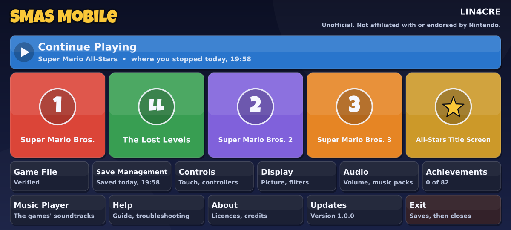
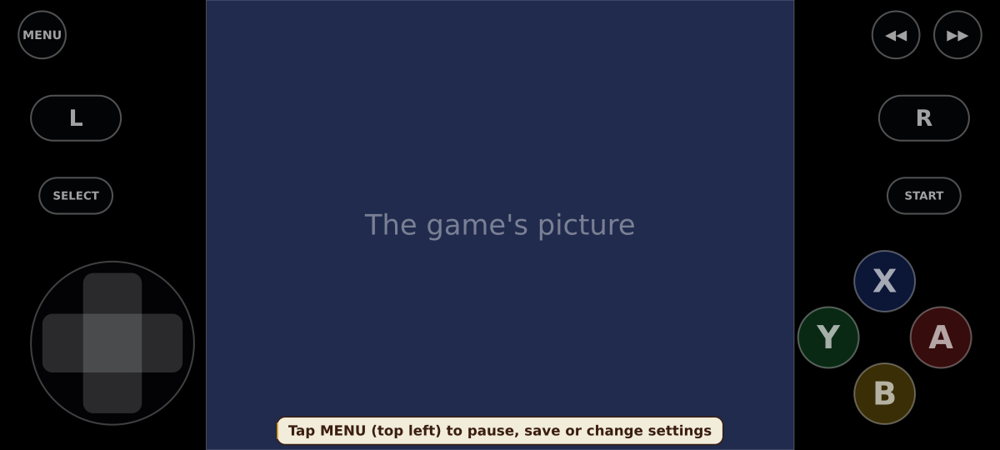
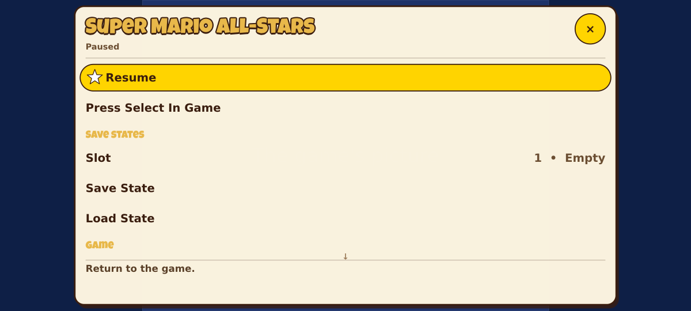

# SMAS Mobile

An unofficial Android app for playing **your own copy** of Super Mario
All-Stars (USA), published by LIN4CRE. It is built on the open-source
[SuperMarioAllStars](https://github.com/Darhkfox/SuperMarioAllStars) port by
Darhkfox (MIT licence).

No game is included, here or in the app. Not affiliated with or endorsed by
Nintendo.

## Status: work in progress

**There is no app to install yet.** The application's code is written and is
tested on a desktop; the Android project that would package it has not been
converted, so no APK can be built from this repository today, and nothing here
has run on a phone.

| Part | State |
| --- | --- |
| Application code (C++, `src/`) | Written. Builds and runs headless on a desktop. Not yet compiled for Android: the Android-only files have only been syntax-checked against stand-in headers. |
| Host tests (`tests/`) | 113 tests pass: safe file writing, the save store, the game-file check, the zip reader and backups, the on-screen controls. |
| Home screen, import, saves and backups as a whole | Written. No automated tests of these flows yet. |
| Android project (`android/`) | **Still upstream's, unchanged.** It names source files that no longer exist, so it does not build. |
| Android activity (file pickers, vibration, safe area, refresh rate) | Not written. The native side that calls it is. |
| App icon, package name, permissions | Still upstream's. |
| Build on GitHub, signed releases | Not set up. GitHub Actions cannot currently run for this account (a billing lock), so no check has run here either. |

What is left, in order:

1. Convert the Android project: package `site.linacre.smas`, the new activity,
   no network permission, an official Gradle wrapper, an original icon.
2. Tests for the hub, settings, and the application's flows (import, save,
   resume, back up, restore).
3. Build workflows, release signing, install and user documentation.
4. A first build, and testing on real devices.

## What it is meant to be

The upstream port already has widescreen, co-op, achievements, save states
and a music player. SMAS Mobile reworks it as a phone app. In the code so far:

* **A home screen** with the four games, Continue Playing, and everything else
  the app does.
* **Your own game file**, chosen with Android's file picker. The app checks
  the file and says what it is (the right game, another version, an archive, a
  save file, another game) before it keeps a copy.
* **Saves that are hard to lose.** Every save is written completely before it
  replaces the old one and is checked when read; the two before it are kept;
  a damaged one is set aside, never deleted. Loading a save state does not
  undo progress a game saved itself. Leaving the app keeps your exact place.
* **Backups**: saves, save states, settings and achievements in one small
  .zip, and restoring it, checked completely before anything is replaced.
* **Touch controls** at the sides of the picture, clear of a display cutout,
  resizable and movable; several fingers at once; optional vibration.
* **Menus sized for a phone**: text and rows scale with the display's density.
* **No network access.** The online update check is gone from the code; the
  network permission goes with the Android project's conversion.

None of this has been tried on a device.

### Pictures of the layout

These are drawn on a desktop by the preview tool (below) from the app's own
drawing code. They are not screenshots of a phone: the phone draws text with
its own font, and no game is shown or involved (the tool sets up the state
shown with a stand-in file).

| | |
| --- | --- |
|  |  |
| The home screen | The on-screen controls, beside the 4:3 picture |
|  | |
| The pause menu | |

## The repository

| Path | What it is |
| --- | --- |
| `src/core`, `src/game` | the emulation core and the game modules (from upstream) |
| `src/app` | the application: hub, menus, saves, backups, the game-file check |
| `src/platform/android` | the Android side: SDL, OpenGL ES, audio, controllers, touch, JNI |
| `android/` | the Gradle project (upstream's, to be converted) |
| `tests/` | host tests, and the preview tool |
| `tools/repo_guard.py` | refuses game files, save files, keys and credentials |
| `third_party/` | the title font and stb |
| `docs/UPSTREAM.md` | what came from upstream and what was changed |

## Running the tests

They need CMake 3.18 or later and a C++17 compiler; nothing else, and no game
file.

```
cmake -S tests -B out/tests -DCMAKE_BUILD_TYPE=RelWithDebInfo
cmake --build out/tests
ctest --test-dir out/tests --output-on-failure
```

`out/tests/smas_tests --list` lists the tests; a word after the program's name
runs the tests whose names contain it.

### The preview tool

It draws the app's screens to picture files, for looking at layout without a
phone. It needs two TrueType fonts on the machine (DejaVu Sans by default).

```
cmake -S tests -B out/tests -DSMAS_PREVIEW=ON
cmake --build out/tests --target smas_preview
out/tests/smas_preview out/preview
python3 tools/ppm2png.py out/preview
```

## Rules for this repository

It is public. Nothing of Nintendo's, nobody's saves, and no secrets go in it:

```
python3 tools/repo_guard.py --all
```

checks the working tree for ROM images, save files, save states, backups,
signing keys and credentials, and for the licence files. Run it before every
commit. A workflow runs the same check on GitHub for every pull request, once
GitHub Actions can run for this account.

## Licence

MIT: see [LICENSE](LICENSE). The original port is Copyright (c) 2026 Darhkfox;
the changes for SMAS Mobile are Copyright (c) 2026 LIN4CRE. See
[NOTICE.md](NOTICE.md) and [THIRD_PARTY_NOTICES.md](THIRD_PARTY_NOTICES.md).

"Super Mario All-Stars", "Super Mario Bros." and "Mario" are trademarks of
Nintendo, named here only to say what the app is compatible with.
